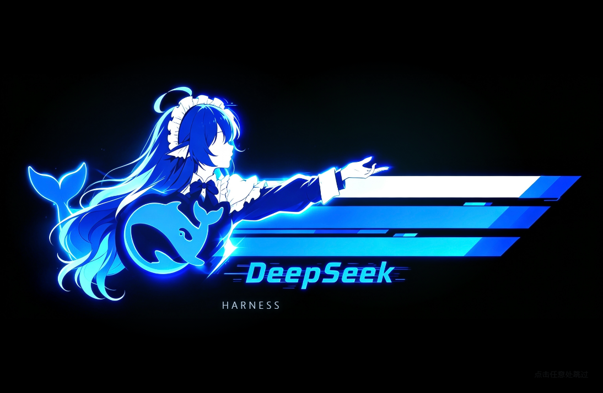
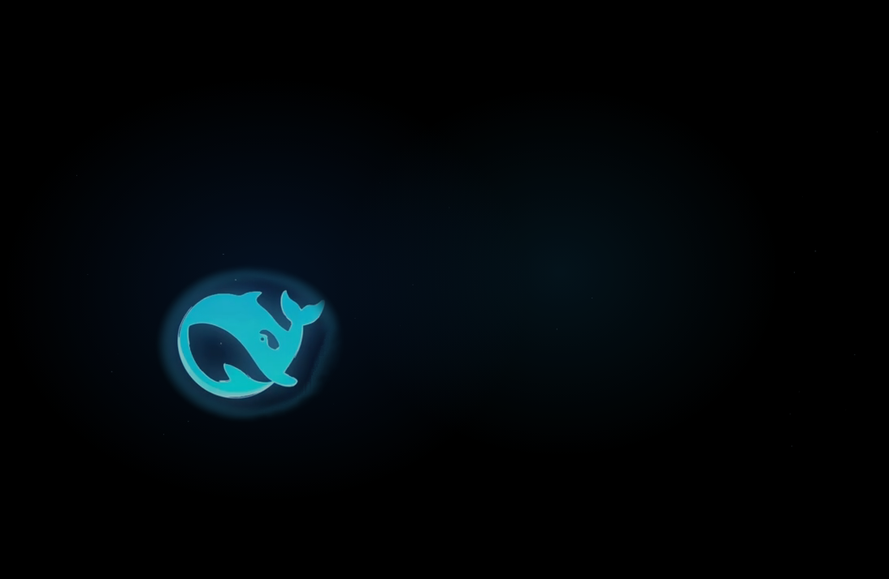

# dsh-startup-animation

DeepSeek Harness 的开机启动动画插件：黑底上鲸鱼点亮 → 人物淡入 → 竖向扫描线 → 环形光轨 → 三条横幅展开 → DeepSeek 字标由模糊转清晰 → HARNESS → 停留 → 淡出进主界面。约 3 秒，点任意处或 Esc 可以跳过。

不改客户端源码，通过 ui-layout 声明的 shell.overlay 槽位挂一层覆盖层，播完自己从 DOM 撤掉。

| 鲸鱼点亮 | 页面前接 |
| --- | --- |
|  |  |

## 安装

    dsh plugin --profile desktop add github:<用户名>/dsh-startup-animation

本地开发用软链接（改完重启即生效）：

    git clone https://github.com/<用户名>/dsh-startup-animation
    dsh plugin --profile desktop add link:D:/path/to/dsh-startup-animation

装完重启 DSH，下一次启动就能看到。卸载：

    dsh plugin --profile desktop remove dsh-startup-animation

## 替换开场

支持三种开场来源，用 localStorage 配置，改完重启生效。在 DSH 窗口的开发者工具里执行：

    // 1) 用一段视频替换（mp4/webm，静音自动播放）
    localStorage.setItem('dsh.startup.intro', JSON.stringify({
      kind: 'video',
      url: 'https://example.com/my-intro.mp4',
      duration: 4,        // 可选：不等视频结束，4 秒后收场
      fadeOut: 0.4,       // 可选：淡出时长
      hint: '点击任意处跳过',
    }))

    // 2) 用一张图替换
    localStorage.setItem('dsh.startup.intro', JSON.stringify({
      kind: 'image', url: 'https://example.com/my-splash.png', duration: 2.5,
    }))

    // 3) 内置动画加速（1 = 原速，2 = 两倍速）
    localStorage.setItem('dsh.startup.intro', JSON.stringify({ kind: 'builtin', speed: 1.5 }))

    // 4) 彻底关掉开场
    localStorage.setItem('dsh.startup.disabled', '1')

    // 恢复内置动画
    localStorage.removeItem('dsh.startup.intro')
    localStorage.removeItem('dsh.startup.disabled')

视频和图片走浏览器原生加载，需要页面能访问到的 http(s) 或 data: URL。加载失败会自动收场，不会卡住界面。

为什么用 localStorage 而不是插件配置项：DSH 的 client 插件入口目前只从宿主 manifest 取 id/url/rev，拿不到 cordis.patch.yml 里给该 entry 的 config。等宿主提供客户端配置通道，这里会换成正规配置项。

## 行为细节

- 窗口出现后先铺一层与启动页同色的底（主题变量 --dsw-alias-bg-base），随后黑幕盖到纯黑，再接动画本体。
- 素材解码与 lead-in 并行；没解码完就停在黑幕上等，不会露出半张图。
- 点画面任意处或 Esc 跳过，进入退场淡出。
- 播完把覆盖层节点从 DOM 移除，点击完全穿透；渲染异常同样收场，不会挡住应用。
- 每次加载只播一次。

## 素材为什么内联

7 张图层以**无损 WebP 的 data URL** 直接写进 lib/client.js（约 2.75 MB），不依赖宿主的包资源路由。

原因：桌面端把 /plugins/<包>/assets/<文件> 转发给 Host 读盘，这条链路在本机实测对这个包全部 404，页面里只剩 DOM 画的几何元素。内联之后加载链路里没有路由、转发、鉴权，client.js 能跑，图就一定在。

无损 WebP 与原始 PNG 的合成结果逐像素一致（黑底、洋红底、alpha 三路比对差值全为 0）。

## 工程结构

    package.json        dsh.bundle.patch + dsh.client(platform:web, inject ui-layout)
    cordis.patch.yml    - insert: [{ id: startup-animation, name: dsh-startup-animation }]
    lib/index.js        node 半：空插件壳
    lib/client.js       浏览器半：__ModuleLoader__.load + shell.overlay 注册 + 动画本体
    lib/assets/*.png    分层素材原始 PNG（改图后重新生成内联数据的源）
    lib/assets/*.webp   内联用的无损 WebP
    docs/engineering-notes.md  这次实现的工程复盘（踩过的坑）

改素材流程：改 lib/assets/*.png → 转无损 WebP（lossless=True, quality=100, method=6）→ 替换 lib/client.js 里 ASSET_DATA 段。

## 兼容性

在 DSH 桌面端 0.2.1-rc.2 上验证。依赖两个公开契约：shell.overlay 槽位（ui-layout 声明）和 window.__ModuleLoader__.load。宿主大版本变化后可能需要跟进。

## 素材与授权

- 插件代码：MIT（见 LICENSE）。
- 动画美术：来自需求方提供的合成原图，公开分发前请确认这些美术资源的使用权。
- 参考录屏只用于核对节奏，不随仓库分发。

## 工程复盘

实现过程中踩的坑、第一次接入失败的根因、影响交付时间的因素，都记在 [docs/engineering-notes.md](docs/engineering-notes.md)。
